# Freelancer Finder: visual architecture

This document explains how the browser, agent, embeddings, SQL verification,
evidence-review loop, and persistent conversation memory work together.

## 1. System context

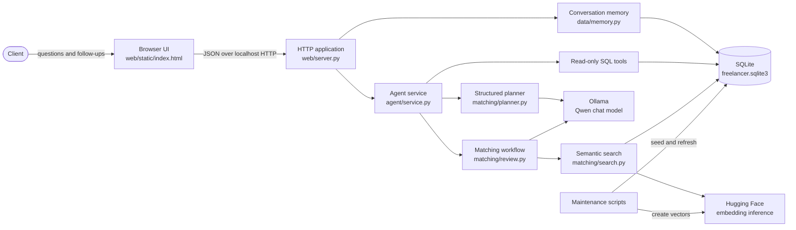

The important boundary is that each component has one responsibility:

- **The LLM understands and reviews.** It creates a structured search plan and
  assesses candidate evidence.
- **Embeddings retrieve.** They rank potentially relevant profiles and projects.
- **SQLite verifies.** Exact skills, availability, rate, currency, location, and
  public portfolio records come from database rows.
- **The web layer remembers.** It loads and saves conversation turns using an
  opaque conversation ID.

Similarity is therefore never treated as proof of professional ability.

## 2. Source-code dependency graph

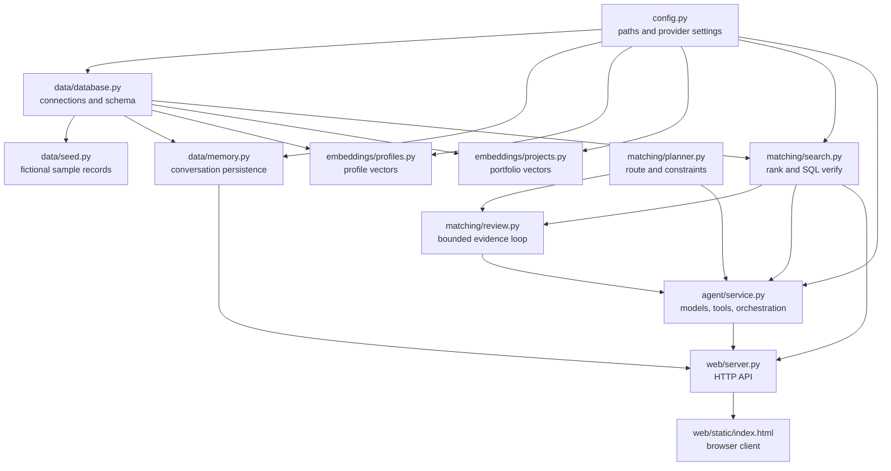

There are no imports from the browser into business logic. The browser only
knows the HTTP contract. Matching code can consequently be tested without a
browser, and memory can be tested without an LLM call.

## 3. Complete chat-request sequence

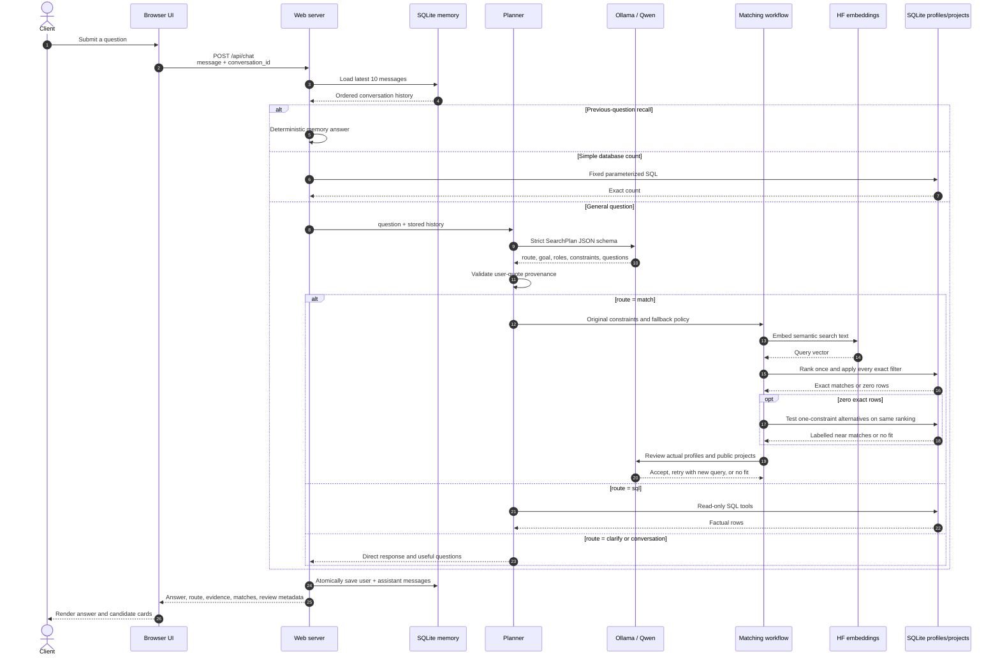

### Why history comes from the server

The browser sends a random `conversation_id`, not the entire transcript. This
prevents accidental duplicate turns and makes a page reload safe. The database
is the authoritative history. For backwards compatibility, API clients without
an ID may still provide an initial `history` array.

## 4. Predictable routing

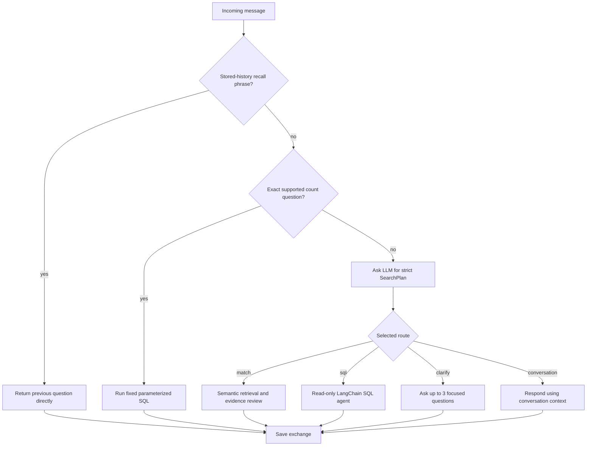

| Route | Used for | Main evidence source |
|---|---|---|
| `match` | Finding or recommending professionals for a goal | Embedding retrieval plus verified SQL records |
| `sql` | Counts, named records, and factual comparisons | Read-only SQLite queries |
| `clarify` | A goal too ambiguous to choose a profession | Conversation and planner reasoning |
| `conversation` | Greetings, scope discussion, and context questions | Stored conversation history |

The planner never uses an inferred skill as an exact database constraint. A
hard constraint must be traceable to a verbatim user phrase. For example,
`with Django skills` can create a Django constraint; `build a web app with AI`
remains a broad semantic preference.

## 5. Semantic matching and evidence-review loop

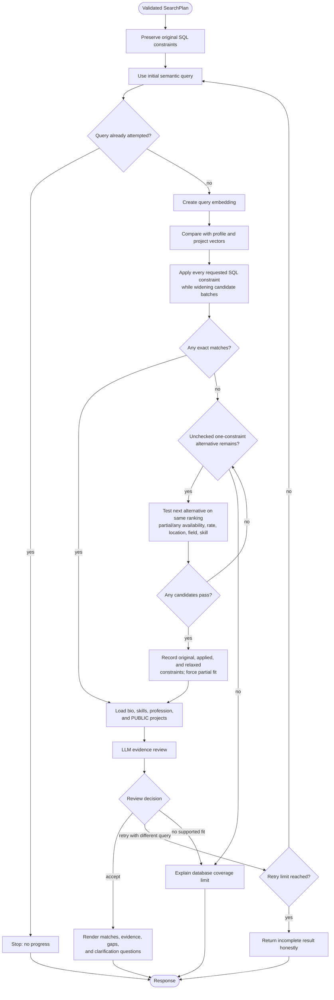

### Loop guarantees

1. Every search tries all original constraints before considering a fallback.
2. A fallback can remove only one condition and keeps every other constraint.
3. Relaxation order is deterministic, and currency is never removed by itself.
4. Every near match is labelled partial and shows the requested versus actual
   value; the LLM cannot hide or add a relaxation.
5. A retry must use a meaningfully different query and repeats the exact-first
   policy.
6. With the default `HF_REVIEW_MAX_RETRIES=2`, there can be at most three search
   attempts: one initial attempt and two revisions.
7. A strong exact match needs actual public-project evidence, not only a high vector
   score.
8. If the evidence is weak, the answer states the gap rather than inventing
   experience.

## 6. How embedding retrieval works

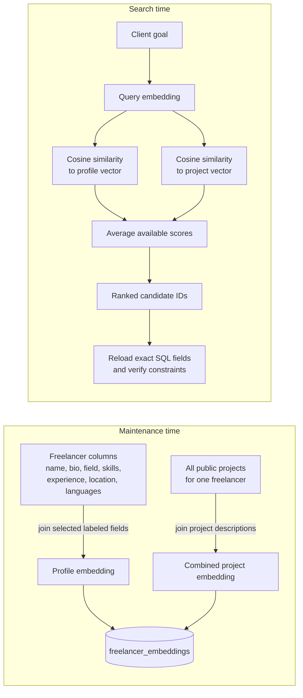

One embedding row belongs to exactly one freelancer through `freelancer_id`.
`embedding_json` represents the selected profile columns;
`project_embedding_json` represents that person's combined public portfolio.
Both use the same model and dimensions before cosine comparison.

The combined similarity score is:

```text
(profile similarity + project similarity) / 2
```

If no project vector exists, only the profile score is used. Scores rank records;
they are not probabilities of successful delivery.

## 7. Conversation-memory lifecycle

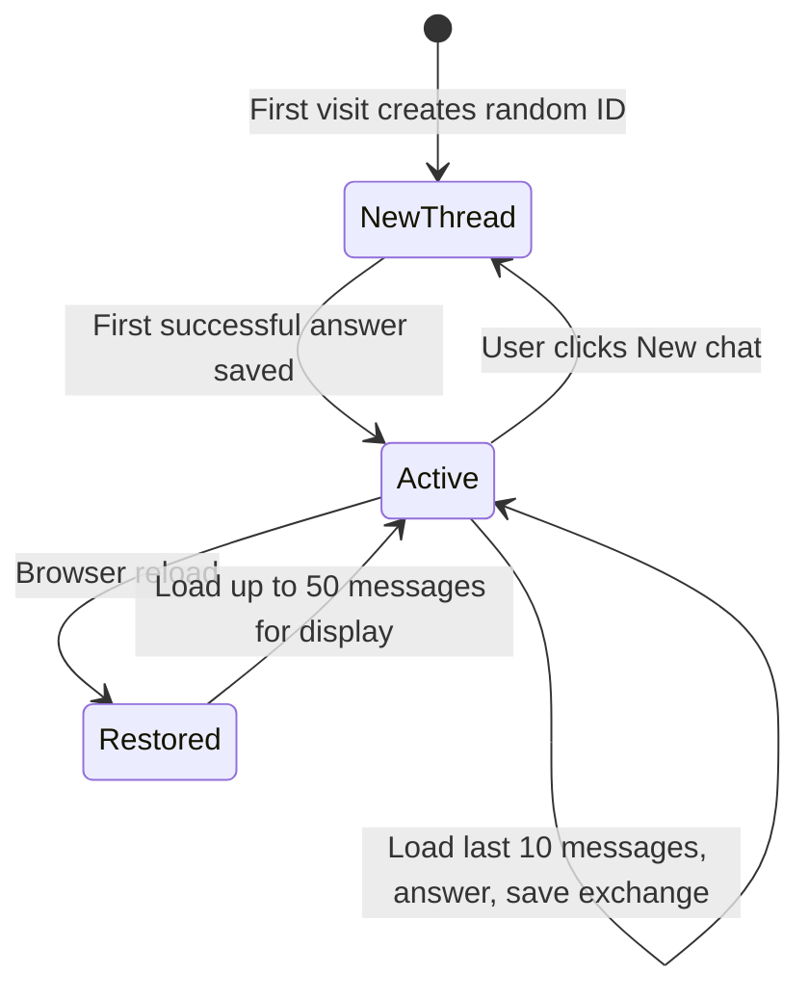

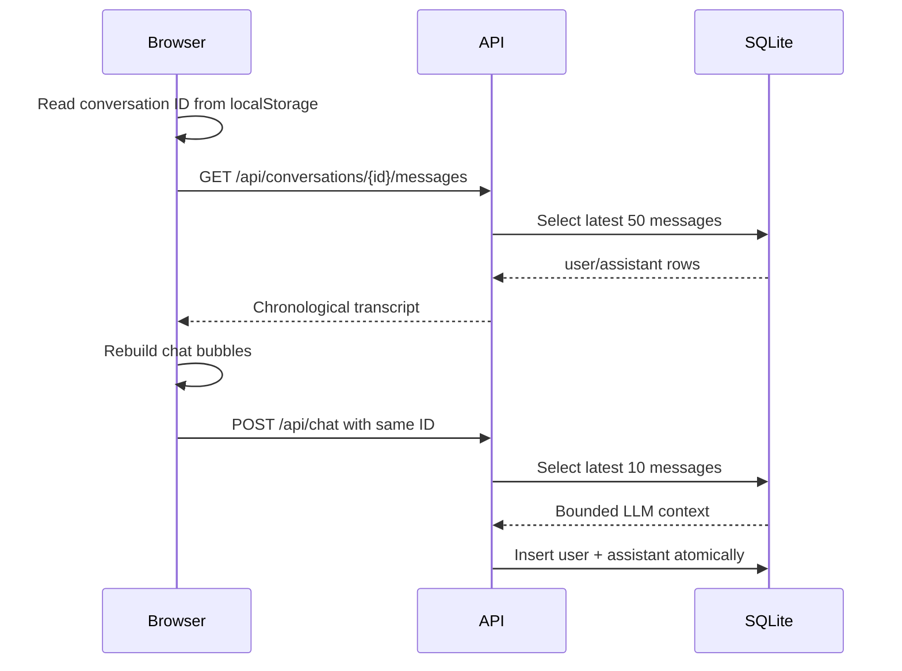

Memory is local to this SQLite database. The demo does not include accounts or
access control. A production service must associate conversations with an
authenticated user, encrypt sensitive data, and define deletion/retention rules.

## 8. Database relationship graph

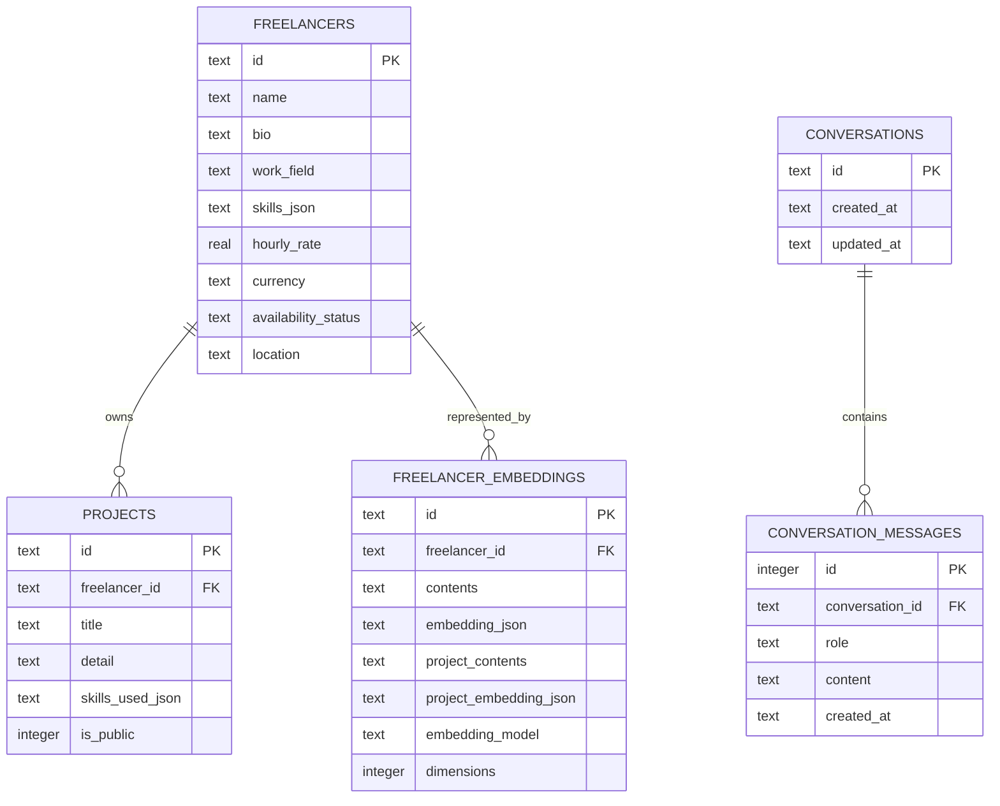

The agent's LangChain SQL tools can see only `freelancers` and `projects`, and
their connection has `PRAGMA query_only = ON`. Conversation writes and embedding
maintenance use separate, explicit application functions.

## 9. Runtime and provider boundaries

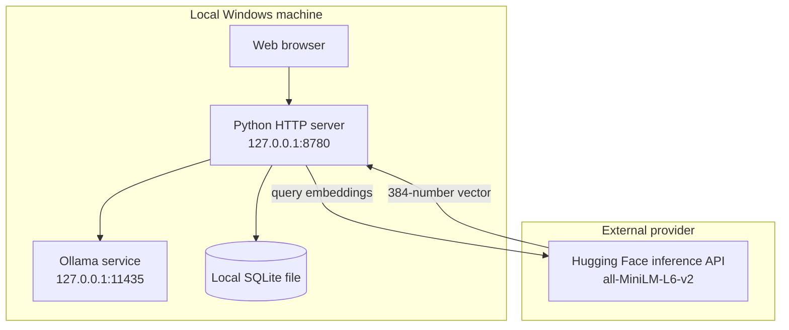

- The chat model and SQL database remain local.
- Text sent for a new embedding query goes to the configured Hugging Face
  inference provider.
- `HF_TOKEN` stays server-side and is never returned by `/api/status`.
- Changing the chat model does not require rebuilding vectors. Changing
  `EMBEDDING_MODEL` does.

## 10. Worked example

For the request:

```text
Find me an available Python developer with Django skills under 60 USD per hour.
```

the pipeline behaves as follows:

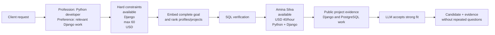

The profession and portfolio ideas help retrieval. Availability, Django, rate,
and currency are exact filters because the client explicitly requested them.

If the next message says `give me one with more 60 dollars`, conversation memory
preserves Python, Django, availability, and USD. The constraint normalizer removes
the old maximum and creates `min_hourly_rate = 60`; SQL can then select a record
such as an available USD 80/hour Django developer.

If the request instead says `under 30 USD per hour` and no exact candidate passes,
the search keeps availability, currency, and Django fixed while checking the next
single relaxation. If removing the rate ceiling finds Amina at USD 40/hour, she is
shown only as a **partial near match**, with both the requested ceiling and her
actual rate visible. The stored request itself is not rewritten.

## 11. Failure behavior

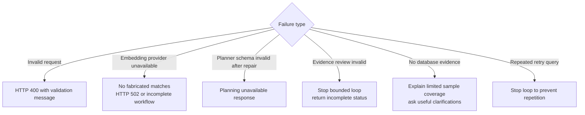

Provider failures never modify freelancer or project records. A conversation
exchange is saved only after the application has produced an answer.

## 12. Where to change behavior

| Goal | File |
|---|---|
| Change models, ports, timeouts, or retry limit | `src/freelancer_finder/config.py` and `.env` |
| Change route-planning rules or constraint validation | `matching/planner.py` |
| Change vector ranking or SQL filters | `matching/search.py` |
| Change evidence requirements or retry behavior | `matching/review.py` |
| Change tool definitions or agent system prompts | `agent/service.py` |
| Change conversation persistence | `data/memory.py` |
| Change API behavior | `web/server.py` |
| Change the browser experience | `web/static/index.html` |
| Change tables or indexes | `data/schema.sql` |
| Change embedded profile fields | `embeddings/profiles.py` |
