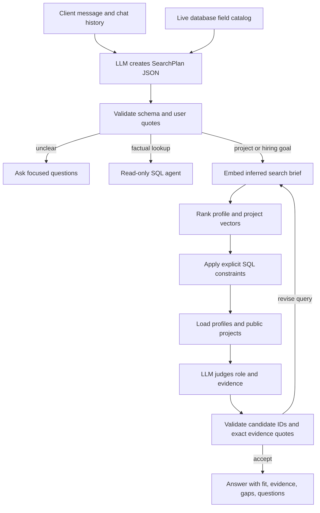

# Intelligent freelancer matching

## Goal

The agent should understand a client's outcome in any professional field, infer
the roles and evidence that would matter, search the current database, and make
recommendations only when stored profile or public portfolio data supports them.
The prompt does not contain special cases for particular industries.

The system can reason about professions worldwide, but it can recommend only
freelancers that exist in the connected database. "Worldwide" means that the
search starts without a country filter. It does not mean that missing people are
created or that credentials are verified outside the database.

## Architecture



## The planner

`project_intent.py` asks the model for a typed `SearchPlan`. The plan contains:

- the client's goal;
- likely professions;
- useful skills;
- portfolio evidence worth looking for;
- selection criteria that still need confirmation;
- explicit hard constraints;
- a semantic retrieval query;
- up to three clarification questions.

The prompt stays domain-neutral. It tells the model to reason from ordinary
language, professional knowledge, and conversation context without using a
fixed industry taxonomy. The database catalog is supplied as coverage
information, not as a list of all possible professions.

The plan is parsed with Pydantic. A malformed response gets one repair attempt.
No search runs when structured output remains invalid.

## Preferences versus hard constraints

The model may infer professions, skills, and useful portfolio examples. These
improve the embedding query but do not exclude candidates by themselves.

A hard constraint must contain an exact quote copied from a user message. Code
then validates the quote and value before creating SQL arguments. This prevents
the model from silently turning an inferred skill into a mandatory skill or a
total project budget into an hourly ceiling. SQL filters are frozen before the
search loop and cannot change during retries.

With no user-stated location, `location=None`, so every stored location is
searched. The same rule applies to currency and availability.

## Retrieval and portfolio evidence

`match_freelancers.py` embeds the search brief with the same embedding model used
for saved freelancer data. It compares the query with both profile and combined
public-project vectors, then ranks candidates by cosine similarity.

`verified_semantic_search` checks explicit constraints against SQLite in widening
batches. `candidate_evidence` then loads the candidate's bio, experience, skills,
languages, and up to four public projects. Private contact data and raw vectors
are not sent to the reviewer.

## Bounded review loop

The loop in `matching_workflow.py` is deliberately small:

```text
freeze explicit SQL filters
query = planner.search_query

for at most 1 initial search + HF_REVIEW_MAX_RETRIES:
    reject a query already attempted
    rank embeddings and apply the frozen SQL filters
    load profile and public-project evidence
    ask the LLM to accept the evidence or revise the retrieval query

    if accepted:
        validate every candidate ID and exact evidence quote
        return supported matches, gaps, and clarification questions

    if retry requested:
        keep all hard filters unchanged
        search once with the meaningfully revised query

return an incomplete status if the limit or provider fails
```

The reviewer distinguishes a strong match from a partial match. It may preserve a
helpful candidate with adjacent evidence and name the missing proof. It may also
accept an empty result when the database has no supported candidate. It cannot
force a match merely because the embedding score is high.

Each recommended candidate needs at least one short quote from that candidate's
profile or a named public project. Application code checks that the quote really
occurs in the specified record. The client sees the evidence and unresolved gaps.

## Model choice

The default is `Qwen/Qwen3.8-27B`. It is the best fit tested through the existing
Hugging Face connection: its official model card emphasizes instruction following,
professional work, and reliable agent execution. In a local comparison, the old
Qwen 2.5 model stopped at generic questions; Qwen 3.8 generated a sensible plan,
searched, evaluated portfolio evidence, and reported the database coverage gap.

Useful choices as of 2026-09-30:

| Model | When to choose it | Integration note |
| --- | --- | --- |
| `Qwen/Qwen3.8-27B` | Best default for this Hugging Face project | Multiple live HF providers; some expose tools and structured output. |
| `openai/gpt-oss-120b` | Strong open-weight alternative for heavier reasoning and tool use | Hugging Face describes it as a general-purpose production model with schema-based function calling; many live providers report structured-output support. |
| `deepseek-ai/DeepSeek-V4.1-Flash` | Long-context or reasoning-heavy experiments | Live HF providers offer tool and structured-output support, but evaluate its output style against this schema before production use. |
| `gpt-6-astra` | Highest-capability managed option if moving from HF to the OpenAI API | Native function calling and structured outputs through the Responses API; requires a separate API integration and billing account. |
| `gpt-6.1-sol` | Managed balance of capability and cost | Near-Astra positioning at lower cost; requires a separate OpenAI integration. |
| `gemini-3.8-flash` | Managed alternative for lower-cost agent workflows | Stable model with function calling, structured output, thinking controls, and a 1M-token context; requires a separate Google integration. |

Choose from the live Hugging Face router rather than assuming a model/provider
pair is available. The router reports context length, latency, tools, and
structured-output support for each active provider.

Primary references:

- [Hugging Face provider model and capability API](https://huggingface.co/docs/inference-providers/en/hub-api)
- [Hugging Face Responses API and structured outputs](https://huggingface.co/docs/inference-providers/main/guides/responses-api)
- [Qwen3.8-27B model card](https://huggingface.co/Qwen/Qwen3.8-27B)
- [gpt-oss-120b model card](https://huggingface.co/openai/gpt-oss-120b)
- [DeepSeek-V4.1-Flash model card](https://huggingface.co/deepseek-ai/DeepSeek-V4.1-Flash)
- [OpenAI model selection](https://developers.openai.com/api/docs/models)
- [OpenAI GPT-6 guide](https://developers.openai.com/api/docs/guides/latest-model)
- [OpenAI structured outputs guide](https://developers.openai.com/api/docs/guides/structured-outputs)
- [Google Gemini 3.8 Flash](https://ai.google.dev/gemini-api/docs/models/gemini-3.8-flash)
- [Google Gemini structured outputs](https://ai.google.dev/gemini-api/docs/structured-output)

## Configuration

```dotenv
HF_MODEL=Qwen/Qwen3.8-27B
HF_MAX_OUTPUT_TOKENS=2048
HF_REVIEW_MAX_RETRIES=2
```

Changing a model requires restarting the Python web server. A browser refresh
does not reload environment variables or backend code.
